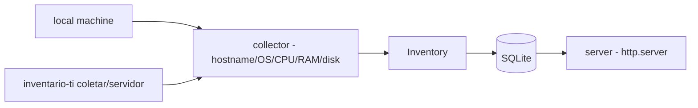

# inventario-ativos-ti

**English** · [Português (Brasil)](README.md)

[](#) [](#) [](LICENSE)

## What it is

**An IT asset inventory tool**: it collects the machine's hardware (hostname, OS, CPU, RAM, disk) on **Windows and Unix** via stdlib, stores it in **SQLite**, and serves the data through a built-in **HTTP server** (`http.server`). It is an educational IT-support automation lab.

## Status

An educational lab, working and tested (25 tests).

## Features

- **Collection** (`collector.py`): `get_hostname`, `get_os_info`, `get_cpu_info`, `get_ram_gb`, `get_disk_gb` — with separate paths for Windows (`wmic`/registry) and Unix (`/proc`, `sysctl`).
- **Model** (`models.py`): `Hardware`, `Software`, `Inventory`.
- **Persistence** (`db.py`): a `Database` class (SQLite).
- **Server** (`server.py`): `make_app(db)` builds a `BaseHTTPRequestHandler` exposing the inventory; `run` starts the service.
- **CLI**: `inventario-ti coletar ...` and `inventario-ti servidor ...`.

## Architecture

An `inventario_ativos_ti` package with `collector` (cross-platform collection), `models` (dataclasses), `db` (SQLite) and `server` (HTTP), orchestrated by the CLI.



## Stack

- Python ≥ 3.10, stdlib only (no psutil)
- pytest (dev)

## Repository layout

```
inventario-ativos-ti/
├── pyproject.toml · BRIEF.md
├── src/inventario_ativos_ti/
│   ├── collector.py   # cross-platform collection
│   ├── models.py · db.py · server.py · __main__.py
├── tests/             # 25 tests
└── LICENSE            # MIT
```

## Prerequisites and installation

```bash
pip install -e .
```

## How to run

```bash
inventario-ti coletar           # collects local hardware and stores it
inventario-ti servidor          # serves the inventory over HTTP
```

## Tests and quality

Real command (verified by the agent):

```bash
PYTHONPATH=src python -m pytest tests/
# 25 passed
```

## Technical decisions and trade-offs

- **Pure stdlib** (no psutil): runs on any Python; the trade-off is per-OS collection paths maintained by hand.
- **Built-in http.server**: simple querying without a framework; not a production server.

## Known limitations and roadmap

- Collection covers basic hardware; installed software (`Software`) has partial support in the model.
- No authentication on the HTTP server.

## Development process

An individual project by Kelvin Oliveira, built with orchestrated AI agents and reviewed by the author.

## License and author

MIT — Copyright (c) 2026 Kelvin Rebelo de Oliveira. Author: [Kelvin Oliveira](https://github.com/KelvinOliveiraCode) · [Portfolio](https://kelvinoliveiracode.github.io/portfolio/)
