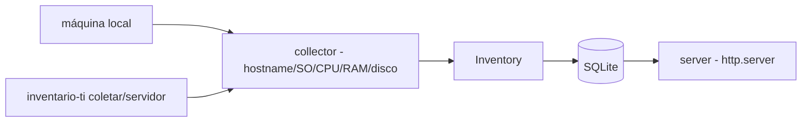

# inventario-ativos-ti

[English](README.en.md) · **Português (Brasil)**

[](#) [](#) [](LICENSE)

## O que é

**Inventário de ativos de TI**: coleta o hardware da máquina (hostname, SO, CPU, RAM, disco) em **Windows e Unix** via stdlib, grava em **SQLite** e serve os dados por um **servidor HTTP** embutido (`http.server`). É um laboratório educacional de automação de Suporte TI.

## Status

Laboratório educacional funcional e testado (25 testes).

## Funcionalidades

- **Coleta** (`collector.py`): `get_hostname`, `get_os_info`, `get_cpu_info`, `get_ram_gb`, `get_disk_gb` — com caminhos separados para Windows (`wmic`/registry) e Unix (`/proc`, `sysctl`).
- **Modelo** (`models.py`): `Hardware`, `Software`, `Inventory`.
- **Persistência** (`db.py`): classe `Database` (SQLite).
- **Servidor** (`server.py`): `make_app(db)` monta um `BaseHTTPRequestHandler` que expõe o inventário; `run` sobe o serviço.
- **CLI**: `inventario-ti coletar ...` e `inventario-ti servidor ...`.

## Arquitetura

Pacote `inventario_ativos_ti` com `collector` (coleta multiplataforma), `models` (dataclasses), `db` (SQLite) e `server` (HTTP), orquestrados pelo CLI.



## Stack

- Python ≥ 3.10, stdlib apenas (sem psutil)
- pytest (dev)

## Estrutura do repositório

```
inventario-ativos-ti/
├── pyproject.toml · BRIEF.md
├── src/inventario_ativos_ti/
│   ├── collector.py   # coleta multiplataforma
│   ├── models.py · db.py · server.py · __main__.py
├── tests/             # 25 testes
└── LICENSE            # MIT
```

## Pré-requisitos e instalação

```bash
pip install -e .
```

## Como executar

```bash
inventario-ti coletar           # coleta o hardware local e grava
inventario-ti servidor          # serve o inventário via HTTP
```

## Testes e qualidade

Comando real (verificado pelo agente):

```bash
PYTHONPATH=src python -m pytest tests/
# 25 passed
```

## Decisões técnicas e trade-offs

- **Stdlib puro** (sem psutil): roda em qualquer Python; em troca, a coleta usa caminhos específicos por SO mantidos à mão.
- **Servidor http.server embutido**: consulta simples sem framework; não é um servidor de produção.

## Limitações conhecidas e roadmap

- A coleta cobre hardware básico; software instalado (`Software`) tem suporte parcial no modelo.
- Sem autenticação no servidor HTTP.

## Processo de desenvolvimento

Projeto individual de Kelvin Oliveira, construído com agentes de IA orquestrados e revisado pelo autor.

## Licença e autor

MIT — Copyright (c) 2026 Kelvin Rebelo de Oliveira. Autor: [Kelvin Oliveira](https://github.com/KelvinOliveiraCode) · [Portfólio](https://kelvinoliveiracode.github.io/portfolio/)
